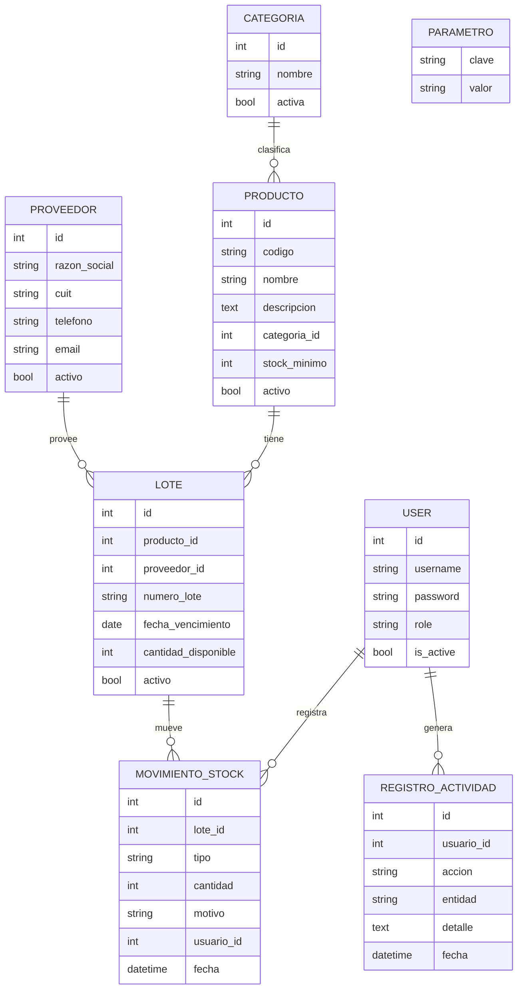

# Modelo de datos

## Restricciones e índices
- `Producto.codigo` único. `Proveedor.cuit` único.
- `Lote`: único `(producto, numero_lote)`; índice en `fecha_vencimiento`; `CheckConstraint(cantidad_disponible >= 0)`.
- `MovimientoStock`: `CheckConstraint(cantidad > 0)`; índice en `(lote, fecha)`.
- Todas las FK con `on_delete=PROTECT`. Nada se borra físicamente.
- Migraciones versionadas en Git: `python manage.py makemigrations` y commitear el archivo generado.
